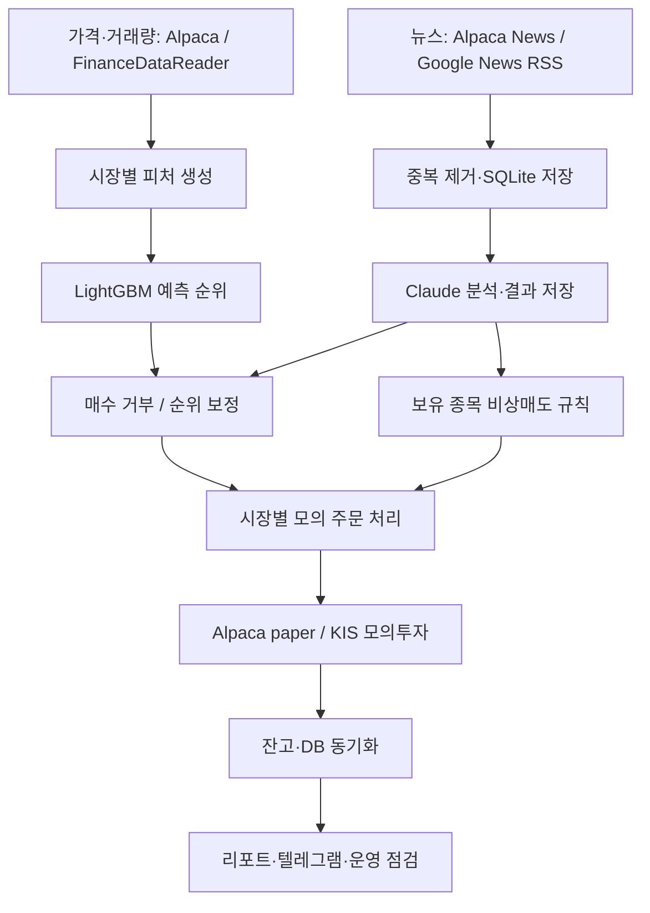

# Stock AI — AI 모의투자 시스템의 설계·운영·종료 기록

**가격 예측 모델과 뉴스 분석 LLM을 미국·한국 증권 API에 연결하고, 약 2개월의 모의 운영에서 성과와 상태 관리 문제를 확인해 실제 자금 투입 없이 종료한 프로젝트입니다.**

씨그로 AI Product Consultant / PM (Forward Deployed Engineer) 신입 지원을 위해, 문제 정의에서 외부 시스템 통합·운영 검증·중단 판단까지의 과정을 정리했습니다. 투자 수익이나 모델의 우수성을 입증하는 자료로 제시하지 않습니다.

이 저장소는 기존 비공개 프로젝트와 분리해 작성한 공개 포트폴리오입니다. 운영은 원본 최종 검토 문서상 **2026-06-01~2026-08-07**입니다. 로컬에 보존된 코드·DB·로그를 대조했으며, 과거 모델 성과와 브로커 수치를 새로 조회하거나 재학습해 검증한 것은 아닙니다.

## 1. 시작한 배경과 해결하려던 문제

가격 데이터에서 얻은 정량 신호와 뉴스의 비정형 정보를 하나의 의사결정 흐름으로 연결하면 어떤 결과가 나오는지 확인하려 했습니다. 예측 모델을 만드는 데서 끝내지 않고, 데이터 수집 → 판단 → 모의 주문 → 결과 기록 → 운영 점검까지 연결하는 것이 과제였습니다.

서로 다른 시장의 거래 시간·API 응답·주문 상태를 다뤄야 했고, 모델의 예측과 실제 운영 결과도 구분해야 했습니다. 최종적으로 가장 큰 학습은 예측 정확도보다 **검증 설계와 외부 시스템·내부 DB의 일치 여부가 결과 해석을 좌우한다**는 점이었습니다.

## 2. 목표·요구사항과 지원자 역할

**목표와 요구사항은 지원자가 직접 정의했고, 코드 구현은 AI의 도움을 받아 함께 진행했습니다.** 설계·운영·분석 과정도 AI와 협업한 프로젝트의 작업으로 설명합니다. 아래 구현 전체를 사람이 단독 작성했다거나, 모든 오류를 독자적으로 발견했다고 주장하지 않습니다.

원본 문서와 코드에서 확인되는 요구사항은 다음과 같습니다. 세부 수치는 운영 당시의 설정이며, 초기 요구사항의 확정 시점을 모두 추적한 것은 아닙니다.

| 요구사항 | 구현과 확인 방식 |
|---|---|
| 실제 자금 투입 전에 검증 | Alpaca paper / KIS 모의투자, 백테스트·워크포워드·운영 기록 비교 |
| 두 시장의 정량 신호 생성 | 미국·한국 별도 LightGBM 모델과 피처·보유 정책 |
| 뉴스 위험 신호 반영 | LLM 점수 구조화, 매수 거부·순위 보정·비상매도 규칙 |
| 반복 실행과 추적 | EC2 실행 스크립트, SQLite 기록, 텔레그램 알림 |
| 결과에 따른 진행 여부 판단 | 월간 점검 계획과 최종 종료 검토 문서 |

공개 초안의 문서 재구성·합성 데이터·오프라인 테스트는 **이번 포트폴리오 정리 과정에서 새로 작성한 산출물**입니다. 당시 운영 기능이나 당시의 테스트 실적으로 소급하지 않습니다.

## 3. 핵심 기능과 시스템 아키텍처



위 그림은 **과거 운영 시스템**입니다. 이 공개 초안의 실행 코드는 합성 입력을 읽어 신호·순위·불일치 경고를 출력하는 범위이며, 주문·네트워크·모델 파일 로더는 포함하지 않습니다.

미국은 일별 상위 3개, 한국은 상위 1개를 후보로 삼았습니다. 당시 정책은 각각 5일·20일 보유였지만, 실제 만기일 계산은 달력일 근사였으므로 정확한 거래일 계산 구현으로 설명할 수 없습니다. [구조와 제약](docs/ARCHITECTURE.md)

## 4. 사용한 기술과 선택 이유

| 기술 | 선택 이유와 확인된 한계 |
|---|---|
| Python·pandas·ta | 가격 데이터와 기술 지표를 같은 파이프라인에서 처리. 실시간 처리·성능 최적화를 검증한 프로젝트는 아님 |
| LightGBM | 원본 설계 기록은 소규모 표 데이터에서 빠르게 실험하기 위한 선택으로 설명. 딥러닝 대비 성능 우위 실험은 없음 |
| Claude API | 뉴스 제목·요약을 감성·중요도·이벤트 유형으로 변환. 최신 코드는 Haiku이며 DB에는 Sonnet 사용 이력도 존재 |
| Alpaca·KIS | 미국·한국 모의투자 환경 통합. 장외 접수·상태 확인 방식의 차이가 운영 이슈로 이어짐 |
| SQLite | 뉴스 분석 캐시와 신호·포지션·행동 기록을 파일 기반으로 유지. 브로커와의 분산 트랜잭션은 보장하지 않음 |
| EC2·shell·cron | 모델 의존성과 예약 실행을 하나의 Linux 환경에서 관리하려는 선택. 서버 가동과 각 작업 성공은 별개 |
| 텔레그램 | 주문·비상 신호·단계 실패를 알림으로 전달. 전달 성공률은 별도 측정하지 않음 |

## 5. AI·ML 모델과 외부 API를 연결한 방법

가격 경로에서는 수익률·이동평균·변동성·거래량·시장 ETF 컨텍스트 등을 계산하고 LightGBM 이진 분류 점수로 종목을 정렬했습니다. 미국 라벨은 5개 데이터 행 뒤 수익률 3% 초과, 한국은 20개 행 뒤 7% 초과입니다. 보존된 선택 피처 목록은 미국 30개, 한국 25개입니다.

뉴스 경로에서는 종목·제목·발행 시각으로 중복 키를 만들고, 미분석 뉴스만 Claude에 보냈습니다. JSON 응답을 파싱해 DB에 저장한 뒤 중요도 가중 감성을 계산했습니다. 원본은 숫자로 변환하지만 허용 범위·이벤트 열거값을 엄격하게 검증하지 않습니다.

- 최근 48시간 뉴스 2건 이상에서 가중 감성 ≤ −5, 최대 중요도 ≥ 5이면 `veto`로 후보에서 제거했습니다.
- 가중 감성 ≥ +5, 최대 중요도 ≥ 5이면 순위 점수에 0.05를 더했습니다. 보정 후 점수는 보정된 확률로 해석할 수 없습니다.
- 비상매도는 72시간 집계 감성 ≤ −6 및 중요도 ≥ 7, 또는 단일 뉴스 감성 ≤ −7 및 중요도 ≥ 8 조건을 사용했습니다. 단일 뉴스 조건은 일반 매수 필터의 최소 2건 조건과 다릅니다.

KIS 래퍼에는 인증 토큰 캐시와 5xx·연결 오류·타임아웃 재시도가 있습니다. 주문 POST의 응답 유실 뒤 재시도 중복을 막는 멱등성 보장은 확인되지 않았습니다. 원본 통합 코드는 [비실행 발췌](reference/README.md)로 확인할 수 있습니다.

## 6. 자동화와 운영 방식

현재 실행 스크립트 기준으로 미국 사이클은 KST 06:00, 한국 매매는 09:05 별도 실행을 권장합니다. 장중 뉴스·위험 점검은 00:00·12:00·18:00을 권장했습니다. 초기 문서의 “06:00에 한국 매매까지 실행, 하루 4회”와 차이가 있습니다. 최종 문서에는 stock-ai 관련 cron 5줄을 중지했다고 기록돼 있습니다. 서버 crontab을 이번에 직접 조회하지는 않았습니다.

각 스크립트는 단계가 실패해도 다음 단계와 리포트를 시도합니다. Linux `flock`은 같은 사이클의 중복 실행을 방지하지만 사이클 간 공통 잠금은 아닙니다. 종료코드가 0이어도 일부 종목 실패가 있었을 수 있어, 실행 완료 메시지를 전체 성공으로 집계하지 않았습니다.

로컬에 회수된 로그는 약 2개월의 실행 흔적을 뒷받침하며 실패 기록도 포함합니다. 원본의 “67일 무중단”은 서버 가동 기록의 주장으로 남기고, **67일간 매매가 모두 정상 완료됐다는 성과로 사용하지 않습니다.**

## 7. 실제 모의 운영 결과와 검증

| 구분 | 확인된 결과 | 근거와 해석 |
|---|---|---|
| 미국 단일 백테스트 | 알파 +6.76%p | 원본 문서 보고값, 이번 재실행 없음. 코드상 벤치마크는 종목군 일별 동일가중 수익률 |
| 미국 워크포워드 | 13분기 평균 +1.71%p, 분기 표준편차 6.7%p | 문서 보고값. 평균의 표준오차 약 1.86%p, t≈0.92 |
| 한국 워크포워드 | 평균 +0.83%p, 표준편차 13.2%p | 문서가 제시한 13분기 가정으로 t≈0.23. 원시 분기별 결과 없음 |
| 미국 모의 운영 | 총 평가수익률 +0.33%, 동일 기간 SPY +1.73% | 최종 검토 문서의 집계. 단순 차이는 −1.40%p이며, 전략 정상 작동의 증거가 아님 |
| 한국 모의 운영 | 총 평가수익률 −4.83% | 최종 검토 문서의 집계. KOSPI 대비 성과는 미측정 |
| LLM 비상매도 | 미국 8건·한국 9건, 양쪽 모두 손실 집계 | 로컬 DB 재집계로 확인. 비상매도를 하지 않았을 때와의 인과 비교는 미실시 |
| 최종 판단 | 실제 자금 투입 없이 종료 | 2026-08-07 최종 검토 문서의 결정·종료 기록 |

원본의 “실현 기준 알파 −3.94%p”는 실현손익/초기자본 −2.21%에서 SPY 총수익률 +1.73%를 뺀 값입니다. 전체 계좌 수익률과 기준이 달라 **동등한 총수익률 비교로 사용하지 않았습니다.**

백테스트에서 워크포워드로 검증 범위를 넓힌 점은 확인됩니다. 다만 현재 워크포워드 코드는 평가할 분기를 early stopping에도 사용하고, 학습 경계에서 미래 라벨의 겹침을 제거하지 않습니다. 따라서 숫자는 유효한 초과수익의 입증이 아니라 **한계가 있는 과거 실험의 보고값**입니다. 13분기의 독립성도 확인되지 않았습니다. [결과·계산·한계](docs/RESULTS.md)

## 8. 주요 오류와 문제 해결 과정

| 문제 | 확인한 사실 | 조치·남은 과제 |
|---|---|---|
| 주문 접수와 DB 기록의 불일치 | 잔고에 없는 전일 `open`을 날짜만 보고 `cancelled`로 바꿈. 대기 주문이 나중에 체결되면 추적에서 빠질 수 있음 | 현재 미국 거래일 가드는 있지만 동기화가 먼저 실행됨. 포트폴리오에서 조건을 합성 데이터로 재현하고 읽기 전용 탐지 예제를 추가. 운영 수정 완료 주장 없음 |
| 손익 집계의 불완전성 | 한국 청산가는 현재가 근사, DB 손익에 거래세 미반영. 정상 청산 3건 중 1건 손익 누락 | 누락을 0원으로 채우지 않고 집계의 유효 건수를 표시 |
| LLM 비상매도 결과 부정적 | 미국 정상 청산 51건 합계 약 −195달러, 비상매도 8건 약 −1,315달러 | 손실이 비상매도 집단에 집중. 뉴스 선택 편향·사후 가격 비교가 없어 “LLM이 손실을 유발했다”는 인과 단정은 보류 |
| 주식분할 미조정 | 현재 수집·추론 코드에 `Adjustment.ALL` 적용 | 과거 오류를 수정했다는 문서 기록과 현재 설정은 확인. 수정 전후 효과는 재현하지 않음 |

미국 DB 정상·비상 청산 합계는 약 −1,510달러이며, 최종 문서의 브로커 실현손익과 다릅니다. 주문 누락·가격 근사 등의 설명은 가능하지만 차이의 원인별 금액을 완전히 대사하지 않았습니다. [장애 분석](docs/INCIDENTS.md)

## 9. 중단 결정과 배운 점

초기 점검 계획에는 일정 성과가 나면 실제 자금을 투입하는 선택지가 있었습니다. 최종 기록에서는 그 계획을 취소했습니다. 양의 평균 알파가 있어도 변동성에 비해 작았고, 운영 손익과 상태 기록에도 신뢰성 문제가 있었으며, LLM 위험 대응의 이익을 입증하지 못했기 때문입니다.

이 프로젝트에서 남긴 판단 기준은 다음과 같습니다.

- 성공 기준과 함께 필요한 표본·평가 기간·비교 기준을 먼저 설계한다.
- 외부 시스템의 접수·체결·취소 상태와 내부 기록의 상태를 구분한다.
- AI 기능을 추가했다는 사실과 업무 결과가 개선됐다는 증거를 구분한다.
- 개선 효과를 검증할 수 없다면 가설로 남기고, 추가 투자 대신 종료도 선택한다.

업무 현장에 적용할 때도 요구사항을 실행 가능한 흐름으로 바꾸는 일과, 그 흐름이 실제로 문제를 해결했는지 확인하는 일을 함께 다뤄야 한다는 경험입니다. 고객 현장 배포나 기업 매출 성과를 수행한 프로젝트로 제시하지는 않습니다.

## 10. 코드 실행과 테스트

Python 3.10 이상과 표준 라이브러리만 사용합니다. API 키·계정·추가 설치가 필요하지 않습니다. 프로젝트 디렉터리에서 실행합니다.

```bash
python3 -B -m stock_ai_portfolio
python3 -B -m unittest discover -s tests -v
python3 -B tools/check_publication.py
```

데모는 합성 뉴스 점수·가짜 예측 점수·가짜 상태 스냅샷을 읽어 JSON을 stdout에 출력합니다. ML 추론·LLM 호출·주문 접수·DB 갱신은 수행하지 않습니다. 실제 모델 성능을 재현하는 데모는 학습 데이터 부재와 공개 권리 미확인 때문에 제공하지 않습니다.

원본 신호 임계값은 유지하되 입력 검증·명시적 시각·미래 뉴스 제외·시장 구분은 이번에 추가했습니다. 상태 탐지는 개선 제안이며 원본 운영에 적용됐던 기능이 아닙니다. [데모 범위](docs/DEMO.md)

실제 실행 결과는 [검증 보고서](reports/VALIDATION.md), [테스트 로그](reports/tests.txt), [데모 출력](reports/demo-output.json)에 있습니다. 검증은 텍스트로만 수행했습니다.

## 11. 추가 기술 문서

- [구현 대조표와 증거 수준](docs/EVIDENCE.md)
- [아키텍처·API 경계·운영 제약](docs/ARCHITECTURE.md)
- [성과 집계와 통계 해석](docs/RESULTS.md)
- [장애 사례와 개선 가설](docs/INCIDENTS.md)
- [선별한 원본 코드 발췌](reference/README.md)
- [데이터·라이브러리·모델 공개 검토](docs/DATA_AND_RIGHTS.md)
- [생성물·제외 항목·공개 전 검토](docs/PUBLICATION_REVIEW.md)
